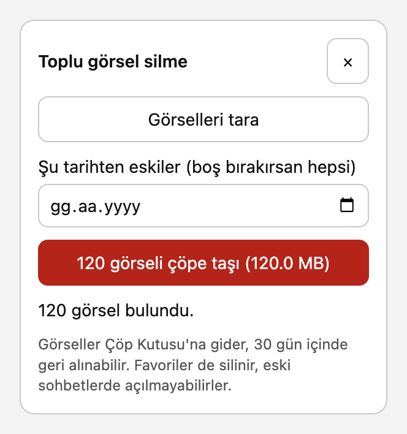

# Bulk Delete for ChatGPT Library

ChatGPT artık depolama sınırı uyguluyor ama Kitaplık'ta "tümünü seç" yok; binlerce görseli tek tek işaretlemen gerekiyor. Bu eklenti Kitaplık sayfasına küçük bir panel ekler ve görselleri toplu olarak Çöp Kutusu'na taşır.

*ChatGPT's library has a storage limit but no "select all". This Chrome extension moves your library images to Trash in bulk. The interface is in Turkish.*

<p align="center"></p>

> OpenAI ile bağlantısı yoktur, resmi değildir. ChatGPT'nin belgelenmemiş iç API'sini kullanır, OpenAI değiştirirse çalışmayı bırakabilir. Kullanım sorumluluğu sana aittir.

## Kurulum

1. Bu repoyu indir (**Code → Download ZIP**) ve klasöre çıkar.
2. Chrome'da `chrome://extensions` adresini aç, sağ üstten **Geliştirici modu**nu aç.
3. **Paketlenmemiş öğe yükle** deyip klasörü seç.

## Kullanım

1. `chatgpt.com/library` sayfasını aç (eklentiyi kurmadan önce açıksa yenile), sağ alttaki **Toplu sil** düğmesine bas.
2. **Görselleri tara**.
3. İstersen bir tarih seç, sadece ondan eski görseller silinir. Boş bırakırsan hepsi silinir.
4. Kırmızı düğmeye iki kez bas (ikincisi onay).

## Silinince ne olur

- Görseller ChatGPT'nin kendi arayüzündeki **Sil** gibi Çöp Kutusu'na gider ve 30 gün sonra kalıcı olarak silinir. Bu süre içinde Çöp Kutusu'ndan geri alabilirsin.
- Proje ve özel GPT dosyalarına, sana ait olmayan dosyalara dokunulmaz.
- **Favoriler korunmaz.** API kayıtlarında favori bilgisi yok, tarih aralığına giren favoriler de silinir.
- Silinen görseller eski sohbetlerde açılmayabilir. Saklamak istediklerini önce indir.

## Gizlilik

Sunucu yok, analitik yok, ek izin yok. Eklenti sadece `chatgpt.com` üzerinde çalışır ve sadece `chatgpt.com`'a istek atar. Oturum anahtarı bellekte tutulur, hiçbir yere kaydedilmez. Kod tek dosya: [`content.js`](content.js).

## Geliştirme

```
node test.js
```

## Lisans

MIT
